## Context

See `proposal.md` — Why. This document records the consolidated shape of the
solution after the first implementation pass was discarded.

**Current state.** `crates/core` has a `Board` that owns a `Grid<u32>`, a fused
`resolve_move`, a thread-local `sample_spawn`, and an `Engine` whose
`make_move` performs merge → node → spawn → node → two edges in one call.
`GameInstance` holds a single `current_board_id`, a score, and a config.

**Constraints that shape the design.**

- The DAG is content-addressed and deduplicated. It must keep that property
  while holding boards from games whose merge behaviour differs.
- `Engine` is serialized and re-imported wholesale. Every piece of live state
  that affects the next action — agent RNG, the Threes deck, spawn credit,
  the last swipe — must serialize with it.
- `crates/tui`, `crates/merge-cli`, and the WASM bridge all consume the engine
  API, so the public facade must stay small and deliberate.
- The board trait is the pivot. Game orchestration must not grow a parallel
  hierarchy above it.

## Goals / Non-Goals

**Goals:**

- Keep one board-level trait with the essential board methods, and build every
  game on top of it without a second gameplay trait.
- Make the board pure content and geometry: no rule value, no randomness, no
  score, no mode.
- Express 2048 and Threes as one board whose `Tile` carries its kind, so merge
  behaviour derives from the tile instead of a separate rule value.
- Make spawning an explicit, spawn-only config that owns values, count, and the
  score formula, and that never reacts to a swipe. Placement policy is the
  slot's `rule`, not the config's.
- Derive score from the board and the spawn record instead of storing a score
  or reporting score deltas.
- Make `Game` and `Table` first-class, with config and spawn variant shared by
  every mode.
- Put graph identity and storage entirely inside the graph module, with
  explicit config and graph schemas.
- Keep the public surface to what other crates actually need.

**Non-Goals:**

- A word tile. The numeric board is `u32` now; the word board is a later
  concrete type implementing the same board trait.
- Networked multiplayer, replayability, or difficulty beyond `RandomBot`.
- A second production board type in this change.
- Preserving the old fused `make_move` contract across the bridge; the bridge
  change is part of this change.

## Design Model

### The pipeline

Every mode is the same three-stage pipeline:

```text
        Swipe ───────────── Board ───────────── Spawn
          │                    │                   │
     tile kind           geometry            values
     (on the tile)        content            count
                                              score credit
                                              placement <- slot.rule
```

- **Swipe** is a board action. Whether two tiles merge is decided by the kind
  carried on each tile; no rule value is supplied at the call site.
- **Board** is the pivot. It owns content, geometry, slide, placement, empty
  positions, and termination. It knows nothing about 2048, Threes, spawning,
  scoring, seats, or modes.
- **Spawn** is a spawn-only config. It owns the value source, the count, and
  the score formula. It is shared by every mode.
- **Placement** is not the config's job. The slot's `rule` says whether a spawn
  may use any empty cell or only the line opposite the last swipe.
- **Score** is not a stage and not stored. It is a function of the board and
  the spawn record, supplied by the spawn config.

### Class diagram

From the board up to the engine, with the corrections so far: the tile carries
its kind, `Geometry` replaces the old grid trait, `BoardSlot` is
`(board, rule)`, the spawn config is data only, the Threes deck is one per
game, and ids belong to the graph.

```mermaid
classDiagram
    direction TB

    class Tile {
        <<enum>>
        Classic(u32)
        Threes(u32)
    }

    class Geometry {
        <<trait>>
        +rows() usize
        +cols() usize
        +get(pos) Option~Tile~
        +set(pos, tile)
        +positions() iterator
        +empties() Vec~Pos~
        +line(direction, index) list of cells
        +slide(direction) Vec~Tile~
        +is_empty() bool
        +is_full() bool
    }

    class BoardGame {
        <<trait>>
        +valid_swipes() Vec~Direction~
        +spawn_space() SpawnSpace
        +apply(action) Result~Board, ActionError~
        +is_terminal() bool
    }

    class Board {
        +grid Grid
    }

    class Action {
        <<enum>>
        Swipe(Direction)
        Place(Vec~Cell~)
    }

    class SpawnRule {
        <<enum>>
        AnyEmpty
        OppositeLine
    }

    class BoardSlot {
        +board Board
        +rule SpawnRule
    }

    class GameConfig {
        +mode ModeConfig
        +rows u8
        +cols u8
        +players u8
        +spawn SpawnConfig
        +difficulty Difficulty
    }

    class ModeConfig {
        <<enum>>
        Single
        Race(shared_spawner)
        Crossfire(strategy)
    }

    class SpawnConfig {
        <<enum>>
        Classic(weights, count)
        Threes(seed)
    }

    class Deck {
        +cards Vec~u32~
        +cursor usize
    }

    class ModeState {
        <<enum>>
        Single
        Race(policy, shared_spawner)
        Crossfire(cursors, strategy)
    }

    class Table {
        +slots list of BoardSlot
        +seats list
        +obligations list
        +agents list
        +round u32
        +acted list
    }

    class Game {
        +id GameId
        +config GameConfig
        +history list
        -table Table
        -mode ModeState
        +swipe(seat, direction) TurnReport
        +place(seat, cells) TurnReport
        +score(slot) u64
        +outcome() Outcome
    }

    class BoardId {
        <<content addressed>>
        +value u64
    }

    class GameId {
        +value u64
    }

    class Edge {
        <<enum>>
        Swipe(Direction)
        Spawn(Vec~Cell~)
    }

    class GraphEdge {
        +from BoardId
        +to BoardId
        +kind Edge
    }

    class GraphStore {
        +nodes map from BoardId to Board
        +edges map from EdgeId to GraphEdge
    }

    class GameState {
        +game Game
        +active_board Board
    }

    class Engine {
        +version u32
        -graph GraphStore
        -games map from GameId to Game
        -next_game_nonce u64
        +create_game(config) GameState
        +swipe(game, seat, direction) GameState
        +place(game, seat, cells) GameState
        +import(data) ImportResult
        +get_graph() GraphData
    }

    Board ..|> Geometry
    Board ..|> BoardGame
    Board --> Tile : cells
    BoardGame ..> Action
    BoardSlot --> Board : holds
    BoardSlot --> SpawnRule : placement
    GameConfig --> ModeConfig : mode
    GameConfig --> SpawnConfig : spawn
    Game --> GameConfig : config
    Game --> ModeState : mode state
    Game --> Deck : Threes only, one per Game
    Game *-- Table
    Table --> BoardSlot : one per slot
    Game ..> Action : one vocabulary
    BoardId ..> Board : content hash
    Engine *-- GraphStore
    Engine *-- Game : many
    Engine --> GameState : returns
    GameState --> Game
    GameState --> Board : active board
    GraphStore --> Board : nodes
    GraphStore --> GraphEdge : edges
    GraphEdge --> Edge : kind
    GraphEdge --> BoardId : endpoints

    note for Board "grid::Grid<Option<Tile>>; None is an empty cell, no zero-tile sentinel"
    note for BoardGame "no rule argument: the tiles answer validity; no id method, identity is a graph concern"
    note for BoardSlot "the settled pair is (board, rule)"
    note for SpawnRule "placement policy: AnyEmpty offers every empty cell, OppositeLine narrows to the line opposite the last swipe; type name is a proposal"
    note for SpawnConfig "data only: weights/count or seed; value drawing and the score formula are free functions over it, not methods"
    note for Deck "Threes runtime state, one deck per Game, cursor serializes with the game"
    note for Table "open: what else a slot stores (credit, player, last swipe), and whether last_swipe is per Game or per slot in Race/Crossfire"
    note for Game "carries no Rule value, no MergeRule, no GameMode trait, no CreateGame payload, and no stored score"
```



### Tiles: a kind and a value

```rust
pub enum Tile {
    Classic(u32),
    Threes(u32),
}
```

Empty cells are `None` in the grid; there is no zero-tile sentinel.

- `Classic`: `2, 4, 8, 16, ...`
- `Threes`: `1, 2, 3, 6, 12, 24, ...`

The tile **is** the kind. Merge behaviour reads it directly, so there is no
`Rule` value on the board, no `MergeRule` struct, and no threshold threaded
through board calls. Only these two kinds exist.

A later word game is a separate concrete board with a word tile type,
implementing the same geometry trait; it does not change the numeric board.

### Geometry

`Geometry` is the trait for positions, lines, and sliding. The `grid` crate
supplies the storage; `Board` implements the trait over it. There is no
in-repo `DenseGrid`.

```rust
pub trait Geometry {
    fn rows(&self) -> usize;
    fn cols(&self) -> usize;
    fn get(&self, pos: Pos) -> Option<Tile>;
    fn set(&mut self, pos: Pos, value: Option<Tile>);

    // provided from the four required methods
    fn positions(&self) -> impl Iterator<Item = Pos> + '_;
    fn indexed_iter(&self) -> impl Iterator<Item = (Pos, Option<Tile>)> + '_;
    fn empties(&self) -> Vec<Pos>;
    fn line(&self, direction: Direction, index: u8) -> Vec<(Pos, Option<Tile>)>;
    fn slide(&mut self, direction: Direction) -> Vec<Tile>;
    fn is_empty(&self) -> bool;
    fn is_full(&self) -> bool;
}
```

`Board` holds `grid::Grid<Option<Tile>>` and implements `Geometry`. There is no
`Board<G: Geometry>`: a board is one value the graph can store, hash, compare,
and serialize, and geometry is already independent of 2048/Threes.

`slide` reads the merge kind off the tiles themselves, and passes operands in
reading order (left/upper tile first) even when scanning right or down.

### The board trait

The board trait keeps only the methods the board itself can answer:

```rust
pub(crate) trait BoardGame: Clone + Eq {
    type Action;

    fn valid_swipes(&self) -> Vec<Direction>;
    fn spawn_space(&self) -> SpawnSpace;
    fn apply(&self, action: &Self::Action) -> Result<Self, ActionError>;
    fn is_terminal(&self) -> bool;
}
```

- `valid_swipes` and `is_terminal` take no rule argument: whether a swipe would
  change the board is answered by the tiles.
- `spawn_space` is every empty position, in stable order. It is the full set;
  the slot's `rule` narrows it when a mode needs the opposite line only.
- `apply` is pure. It returns the new board only; it does not report a score or
  the produced tiles.
- There is no `id` method. Identity is a graph concern.

The numeric board is:

```rust
pub(crate) struct Board {
    pub(crate) grid: grid::Grid<Option<Tile>>,
}
```

It has no rule, no threshold, no deck, no score, and no RNG.

Merge is a function of the tile kind:

- **`Classic`**: equal tiles merge. `2 + 2 = 4`, `8 + 8 = 16`.
- **`Threes`**: below `3`, different tiles merge only when their sum is at most
  `3` -- `1 + 2 = 3`, while `1 + 1` and `2 + 2` do not. At or above `3`, equal
  tiles merge -- `3 + 3 = 6`, `6 + 6 = 12`.

### The spawn variant

The spawn variant is **spawn-only**. It owns what is spawned and how the spawn
affects the score. It never owns a swipe callback.

```rust
pub(crate) enum SpawnVariant {
    Classic(ClassicSpawn),
    Threes(ThreesSpawn),
}

pub(crate) struct ClassicSpawn {
    pub weights: HashMap<u32, u32>,
    pub count: SpawnCount,
}

pub(crate) struct ThreesSpawn {
    pub deck: Deck,
}

pub(crate) struct Deck {
    pub cards: Vec<u32>,
    pub cursor: usize,
}
```

The spawn variant is asked only spawn-side questions:

```rust
impl SpawnVariant {
    pub fn candidates(&self, context: &SpawnContext<'_>) -> Vec<Pos>;
    pub fn count(&self, empties: usize) -> usize;
    pub fn values(&mut self, rng: &mut RngState, count: usize) -> Vec<u32>;
    pub fn spawn_credit(&self, tile: u32) -> u64;
    pub fn score(&self, board: &Board, credit: u64) -> u64;
    pub fn default_merge(&self) -> MergeRule;
}
```

`SpawnContext` supplies the board and the board's last swipe:

```rust
pub(crate) struct SpawnContext<'a> {
    pub board: &'a Board,
    pub last_swipe: Option<&'a SwipeTrace>,
    pub chosen: &'a [Pos],
}

pub(crate) struct SwipeTrace {
    pub direction: Direction,
    pub changed_lines: Vec<u8>,
}
```

`SwipeTrace` lives on `Game`, not on the variant. The game updates it after a
successful swipe; the variant reads it when a spawn is due. This is the
redesign that removes `after_swipe`:

- A Classic spawn ignores the trace and offers every empty position.
- A Threes spawn uses the trace to offer empty cells on the edge opposite the
  swipe, in the lines the swipe actually changed.
- An opening spawn has no trace, so it offers every empty cell.

The variant never mutates during a swipe, and no swipe-side method exists on
it. The only mutation is the deck cursor advancing when values are drawn.

The variant is shared by every mode. A per-slot `credit` value (described
below) carries the spawn-side score contribution so a shared variant does not
need per-slot mutable state.

### Scoring: derived, not stored

There is no `score` field on a slot, no `ScoreDelta`, and no `Scoring` enum.
The spawn variant owns the formula because the formula depends on what was
spawned.

**Classic.** The running 2048 score is the sum of all merge outputs. It can be
recovered from the board and the values that ever entered it:

```text
value(t) = t * (log2(t) - 1)

score(board, credit) = Σ value(tile) - credit
credit               = Σ value(spawned tile)
```

Only spawns above `2` contribute to `credit`; a `4` contributes `4`, an `8`
contributes `16`. This is the formula from the earlier discussion.

**Threes.** The rarity table is a pure function of the board:

```text
rarity(t) = 0                    for t < 3
rarity(t) = 3^(k + 1)            for t = 3 * 2^k
```

So `3 → 3`, `6 → 9`, `12 → 27`, `24 → 81`. The score is the sum over the
board; spawned `1`s and `2`s contribute nothing, and the variant therefore
does not need a credit adjustment.

`SpawnVariant::spawn_credit` returns the value to add to the slot's credit,
and `SpawnVariant::score` computes the score from the current board and that
credit. The game computes a score on demand; nothing stores one.

### Game and Table are first-class

There is no `GameMode` trait, no `Game<M>`, and no `AnyGame`. One struct owns
the game, and one `Table` owns the shared state:

```rust
pub struct Game {
    pub id: GameId,
    pub config: GameConfig,
    pub variant: SpawnVariant,
    table: Table,
    mode: ModeState,
    history: Vec<Action>,
    last_swipe: Option<SwipeTrace>,
}

pub(crate) struct Table {
    pub slots: Vec<Slot>,
    pub seats: Vec<Seat>,
    pub obligations: Vec<Obligation>,
    pub agents: Vec<Agent>,
    pub round: u32,
    pub acted: Vec<SeatId>,
}

pub(crate) struct Slot {
    pub id: BoardSlot,
    pub board: Board,
    pub credit: u64,
    pub player: Option<PlayerId>,
}

pub(crate) enum ModeState {
    Single,
    Race { policy: SpawnPolicy, shared_spawner: bool },
    Crossfire { cursors: Vec<BoardSlot>, strategy: TargetStrategy },
}
```

`config` and `variant` are on `Game`, so every mode receives them. No mode
carries its own copy of dimensions, merge threshold, weights, deck, or spawn
count. The mode-specific state is only what genuinely differs: the Race
fairness policy, or the Crossfire cursors and target strategy.

`Game` is the public gameplay surface:

```rust
impl Game {
    pub fn seats(&self) -> &[Seat];
    pub fn obligations(&self) -> &[Obligation];
    pub fn board(&self, slot: BoardSlot) -> Option<&Board>;
    pub fn candidates(&self, seat: SeatId, chosen: &[Pos]) -> Candidates;
    pub fn swipe(&mut self, seat: SeatId, direction: Direction) -> Result<TurnReport, GameError>;
    pub fn place(&mut self, seat: SeatId, cells: Vec<Cell>) -> Result<TurnReport, GameError>;
    pub fn pending(&self) -> Vec<SeatId>;
    pub fn score(&self, slot: BoardSlot) -> u64;
    pub fn outcome(&self) -> Option<Outcome>;
}
```

`swipe` and `place` build the shared `Action`, call one private `play`, run
the mode wiring (which is the only match on `ModeState`), and drive every
automated obligation that becomes due until a human obligation is pending.
They return a `TurnReport` of board transitions; the engine records those into
the graph.

A mode is a private set of wiring methods selected by `ModeState`, not a
public trait. Adding a mode adds a variant and its wiring; no public
abstraction changes.

### Ids live in the graph

`BoardId`, `EdgeId`, and `GameId` move from `types.rs` into
`graph/ids.rs`. The board trait loses `id`; the graph computes board identity
because identity depends on both content and the merge threshold.

```rust
pub struct BoardId(u64);
pub struct EdgeId(u64);
pub struct GameId(u64);

impl BoardId {
    pub fn from_node(node: &BoardNode) -> Self {
        let mut h = Fnv1a::new();
        h.write_u32(node.merge.split);
        node.board.hash_content(&mut h);
        Self(h.finish())
    }
}
```

Two boards with the same cells but different merge thresholds have different
futures, so they must not share a node. Including the threshold is what keeps
one graph store correct when a Classic game and a Threes game run together.
The board itself still carries no rule.

### Graph storage schema

The graph is an explicit pair of maps. There is no hidden index to rebuild.

```rust
pub(crate) struct BoardNode {
    pub merge: MergeRule,
    pub board: Board,
}

pub(crate) struct GraphEdge {
    pub from: BoardId,
    pub to: BoardId,
    pub kind: Edge,
}

pub(crate) enum Edge {
    Swipe(Direction),
    Spawn(Vec<Cell>),
}

pub(crate) struct GraphStore {
    pub nodes: HashMap<BoardId, BoardNode>,
    pub edges: HashMap<EdgeId, GraphEdge>,
}
```

`EdgeId` hashes `(from, to, kind tag, payload)`: tag `0` for `Swipe` with the
direction, tag `1` for `Spawn` with each cell's position and value.

The serialized graph schema is:

```json
{
  "nodes": {
    "<BoardId>": {
      "merge": { "split": 2 },
      "board": {
        "dim": [4, 4],
        "tiles": [{ "pos": { "r": 0, "c": 1 }, "tile": 2 }]
      }
    }
  },
  "edges": {
    "<EdgeId>": {
      "from": "<BoardId>",
      "to": "<BoardId>",
      "kind": { "Swipe": "Left" }
    }
  }
}
```

The graph stores boards, merge thresholds, and board actions. It never stores
a game, a seat, a slot, a score, a spawn variant, or a mode.

### Config schema

Creation takes a shared config and a spawn-variant config:

```rust
pub struct CreateGame {
    pub config: GameConfig,
    pub variant: VariantConfig,
}

pub struct GameConfig {
    pub mode: ModeConfig,
    pub rows: u8,
    pub cols: u8,
    pub players: u8,
    pub merge: Option<MergeRule>,
    pub difficulty: Difficulty,
}

pub enum ModeConfig {
    Single,
    Race { shared_spawner: bool },
    Crossfire { strategy: TargetStrategy },
}

pub enum VariantConfig {
    Classic { weights: HashMap<u32, u32>, count: SpawnCount },
    Threes { seed: u64 },
}

pub enum SpawnCount {
    Fixed(u8),
    ByEmpties,
}
```

`merge: None` means the variant's default: `MergeRule::CLASSIC` for Classic,
`MergeRule::THREES` for Threes. An explicit `merge` overrides it, so `split: 4`
is a real game configuration rather than a code change.

At creation the engine builds the live `SpawnVariant` from `VariantConfig`:
Classic keeps weights and count; Threes shuffles a deck from the seed. `Game`
stores the resolved `GameConfig` and the live `SpawnVariant`.

A creation payload:

```json
{
  "config": {
    "mode": { "Race": { "shared_spawner": true } },
    "rows": 4,
    "cols": 4,
    "players": 3,
    "merge": null,
    "difficulty": 1
  },
  "variant": {
    "Classic": {
      "weights": { "2": 9, "4": 1 },
      "count": { "Fixed": 1 }
    }
  }
}
```

A Threes single-player payload:

```json
{
  "config": {
    "mode": "Single",
    "rows": 4,
    "cols": 4,
    "players": 1,
    "merge": null,
    "difficulty": 1
  },
  "variant": { "Threes": { "seed": 42 } }
}
```

The engine serialization schema is:

```json
{
  "version": 2,
  "graph": { "nodes": {}, "edges": {} },
  "games": {
    "<GameId>": {
      "id": "<GameId>",
      "config": { "mode": "Single", "rows": 4, "cols": 4, "players": 1, "merge": null, "difficulty": 1 },
      "variant": { "Threes": { "deck": { "cards": [1, 2, 3], "cursor": 0 } } },
      "table": {
        "slots": [{ "id": 0, "board": {}, "credit": 0, "player": 0 }],
        "seats": [],
        "obligations": [],
        "agents": [],
        "round": 0,
        "acted": []
      },
      "mode": "Single",
      "history": [],
      "last_swipe": null
    }
  },
  "next_game_nonce": 1
}
```

### Module diagram

```text
crates/core/src
│
├── lib.rs                 facade: re-exports only
├── hash.rs                Fnv1a
│
├── grid/
│   ├── mod.rs             Grid<T> trait · Pos
│   └── dense.rs           DenseGrid<T>
│
├── board/
│   ├── mod.rs             BoardGame trait · Action · Cell · Direction
│   │                      SpawnSpace · ActionError
│   ├── numeric.rs         Board { grid: DenseGrid<u32> } · impl BoardGame
│   └── merge.rs           MergeRule { split } · merge
│
├── graph/
│   ├── mod.rs             GraphStore · BoardNode · GraphEdge · Edge · GraphData
│   └── ids.rs             BoardId · EdgeId · GameId
│
├── game/
│   ├── mod.rs             Game (first-class) · Table · Slot · Seat
│   │                      Obligation · Agent · ModeState
│   ├── config.rs          CreateGame · GameConfig · ModeConfig
│   │                      VariantConfig · SpawnCount · Difficulty
│   ├── spawn/
│   │   ├── mod.rs         SpawnVariant · SpawnContext · SwipeTrace
│   │   ├── classic.rs     ClassicSpawn
│   │   └── threes.rs      ThreesSpawn · Deck · rarity
│   ├── single.rs          private Single wiring
│   ├── race.rs            private Race wiring
│   ├── crossfire.rs       private Crossfire wiring
│   └── fairness.rs        SpawnPolicy · Shortfall · Divergence
│
├── engine.rs              Engine · GameState · SlotState · ImportResult
└── ...
```

Dependency direction:

```text
  grid ──▶ board ──▶ game ──▶ engine ──▶ wasm · tui · merge-cli
             │          │         ▲
             └──▶ graph ┘─────────┘
```

- `grid` knows only `Pos` and storage.
- `board` knows `grid`, and nothing about games.
- `game` knows `board` and `graph::ids`, and nothing about `GraphStore`.
- `graph` knows `board` and `ids`, and nothing about games.
- `engine` is the only place that joins a `Game` to a `GraphStore`.

### Visibility

Only the facade is `pub`:

```text
pub
  Engine · GameState · SlotState · ImportResult
  CreateGame · GameConfig · ModeConfig · VariantConfig
  SpawnCount · Difficulty · TargetStrategy
  Action · Direction · Pos · Cell · SpawnSpace
  Board · MergeRule
  BoardId · EdgeId · GameId
  Edge · GraphData · Outcome · Candidates

pub(crate)
  Game · Table · Slot · Seat · Obligation · Agent · ModeState
  SpawnVariant · ClassicSpawn · ThreesSpawn · Deck
  SpawnContext · SwipeTrace · SpawnPolicy · TurnReport
  BoardGame · Grid · DenseGrid · GraphStore · BoardNode

private
  line/slide helpers · merge helpers · score helpers · mode wiring helpers
```

Tests use `pub(crate)` types directly. No public method exists only to forward
to another public method. `Board::swipe`, `Board::place`, `Game::swipe`,
`Game::place`, and `Engine::swipe` each do the work their name says.

### Modes

Every mode is the same pipeline with a different seat table:

| Mode | Slots | Swipe seats | Placement seats | Spawn scope |
|---|---|---|---|---|
| `Single` | 1 | one human | one bot | the one slot |
| `Race` | N | one per player | one shared bot (default) | every live slot |
| `Crossfire` | N ≥ 2 | one per player | one per player | one rotating target |

All three use the same `Board`, the same `GameConfig`, and the same
`SpawnVariant`. The variant is selected at creation and can be Classic or
Threes under any mode. A Threes spawn in Crossfire uses the target board's
last swipe trace to choose its edge; a Classic spawn uses every empty cell.

### The turn

```text
Engine::swipe(game, seat, dir)
  → Game::swipe
    → Board::apply(Swipe(dir), merge)
    → update last_swipe (direction + changed lines)
    → create the placement obligation
    → drive automated seats until a human obligation is pending
    → TurnReport { transitions, created, resolved, pending }

Engine records each transition:
  insert before/after boards with Game::merge()
  insert the Swipe or Spawn edge

Engine::place(game, seat, cells)
  → Game::place
    → SpawnVariant::candidates / values / spawn_credit
    → Board::apply(Place(cells), merge)
    → update slot credit
    → create the next swipe obligation
    → TurnReport
```

The engine never invents a transition. It records the transitions the game
reports and returns the new state.

### Opening and termination

- Creation inserts empty boards and an opening placement obligation. The
  opening spawn is the first action; there is no seeded starting tile.
- A Threes opening has no swipe trace, so it may place on any empty cell.
- A slot is terminated when it has no valid swipe. A terminated slot has no
  empty positions, so it leaves the placement scope and the round gate.
- A match ends when every slot is terminated. Scores are then computed from
  each slot's board and credit, and the highest score wins.

## Decisions

### D1. One board trait; one first-class Game

`BoardGame` is the only gameplay contract below the engine. It describes what a
board can answer. `Game` is a concrete struct with a concrete `Table`; game
orchestration is not a second trait. The `Table` already holds every shared
ingredient, so a `GameMode` trait would only add a parallel dispatch layer.

*Alternative rejected:* `Table` + `GameMode` trait, or `Game<M>` + `AnyGame`.
Both duplicate the same match, force an associated type, and still need one
match at storage.

### D2. The board holds no rule

A `Rule` value on the board fixes the merge to the stored content, so the same
cells cannot participate in two variants without duplicating the board. The
merge threshold is a game setting passed into `valid_swipes` and `apply`. The
graph stores the threshold next to the board because identity depends on it;
the board value stays pure content.

### D3. Numeric tiles stay natural

`u32` is the numeric tile. There is no `Tile` enum and no signed sentinel.
Threes' `3`, `6`, `12` are stored as themselves. A later word game is a
different concrete board with a different tile type, implementing the same
board trait. This keeps the numeric graph readable and avoids a tag on every
cell.

### D4. Merge is a threshold, not a rule enum

`MergeRule { split }` expresses both games and every intermediate:

- `split = 2`: equal tiles at or above 2 merge; classic 2048.
- `split = 3`: different tiles below 3 merge when their sum is at most 3;
  equal tiles at or above 3 merge; Threes.
- `split = 4`: `1 + 2` and `1 + 3` merge; `2 + 3` does not.

The threshold is configuration, so a new numeric variant is not a new type.

### D5. Spawn variant is spawn-only

The variant answers four spawn-side questions — where, how many, which values,
and what the spawn contributes to the score — plus the variant's default merge.
It has no swipe method, no `after_swipe`, and no mode knowledge. The game owns
`SwipeTrace` and passes it as context when a spawn is due.

### D6. Scoring is derived

The board reports no score and `apply` returns no score delta. Classic score is
`Σ t·(log2 t − 1)` minus the spawn credit; Threes score is the rarity sum over
the board. The spawn variant owns both formulas, and the game computes a score
when it needs one. A slot stores only the spawn credit, which is spawn
bookkeeping, not a score.

### D7. Config and spawn variant are shared by all modes

`GameConfig` and `SpawnVariant` are fields on `Game`. A mode adds only its seat
wiring, fairness policy, or target cursors. This prevents dimensions, merge,
weights, deck, and count from being repeated per mode and drifting.

### D8. Table is first-class

`Table` owns slots, seats, obligations, agents, the round, and the acted set.
`Game` owns the table and the mode wiring. No trait sits between them.

### D9. Ids belong to the graph

`BoardId`, `EdgeId`, and `GameId` live in `graph/ids.rs`. The board trait does
not report identity. `BoardId` hashes the merge threshold and content;
`EdgeId` hashes the transition; `GameId` is nonce-derived. The graph node
stores the merge threshold so identity can be recomputed on import.

### D10. Grid is a trait; Board is concrete

`Grid<T>` is the reusable geometry contract. `DenseGrid<T>` is the in-repo
implementation. `Board` is the concrete numeric board and holds
`DenseGrid<u32>`. There is no `Board<G>`: the graph needs one concrete board
value, and geometry does not vary with the game.

### D11. Public surface is a facade

Only cross-crate needs are `pub`. `Game`, `Table`, `SpawnVariant`,
`BoardGame`, `Grid`, `GraphStore`, and their helpers are `pub(crate)` or
private. No shallow public aliases.

### D12. One action vocabulary and obligations

`Action` is `Swipe(Direction) | Place(Vec<Cell>)`. The obligation says whether
a swipe or a placement is due and which slot it targets. The seat's scope says
where a shared placement applies. A mode never invents a second move type.

### D13. Placement fairness is structural

A placement seat's candidate set is fixed before an agent chooses: the
intersection of the fillable slots' empty sets, degraded by identical-empty-set
clusters, then independent. The agent chooses within that set; it cannot widen
it. The no-skip ledger records and repays shortfalls and marks divergence.

### D14. Spawn count is configuration

`SpawnCount::{Fixed, ByEmpties}` belongs to the Classic spawn variant. The
Threes variant places one card. A scaled count is `ceil(ln(empties))`, clamped
to the slot's empties and never below one for a fillable slot.

### D15. The engine is the driver and recorder

`Game` drives automated obligations until a human obligation is pending.
`Engine` records the resulting transitions into the graph and returns the
state. Agent RNG, the deck, the spawn credit, and the last swipe all serialize
with the game.

### D16. A match opens with a spawn

Creation inserts empty boards and resolves an opening placement. No starting
tile is special-cased. Every tile, including the first, arrives through the
spawn variant.

### D17. `Edge::Move` becomes `Edge::Swipe`

"Move" no longer names a game action; the edge carries a board-level swipe.
The serialized kind tag stays `0`, so edge identity for an unchanged
transition is stable.

## Risks / Trade-offs

- **Threshold in `BoardId` means variants do not share nodes.** Two games with
  different `split` values never converge, even on identical cells. That is
  correct: their futures differ. The graph remains one store.
- **Recomputing score is O(cells).** Boards are small, and a score is computed
  only when the UI or an outcome asks. If it ever matters, a cached score can
  be added without changing the formula.
- **The merge threshold is threaded through board calls.** This is deliberate.
  Storing it on the board would make the board content-dependent; passing it
  keeps the board pure and makes the variant explicit at the call site.
- **Spawn credit is per slot.** A shared spawn variant cannot hold one credit
  for several boards. The credit lives on the slot and is passed into the
  variant's score formula.
- **Old exports stop deserializing.** `Engine::version` is bumped with the
  graph-format change, and the version is checked before the graph is parsed.
- **`tui` and `merge-cli` use the old fused API.** They must be ported to the
  `Game` verbs and to the graph's explicit schema.
- **The Threes deck is serialized state.** Import must restore the deck cursor,
  or the next card changes. The export/import test covers it.
- **Crossfire with the Threes variant needs a swipe trace.** The target board's
  last trace is used; if none exists, any empty cell is admissible. The spec
  states this explicitly.

## Migration Plan

1. **Group 2:** `Grid` trait + `DenseGrid`, `MergeRule`, the board trait, the
   concrete numeric `Board`, graph IDs, and the graph node schema. Route the
   existing fused `Engine::make_move` through these pieces behind the old
   signature. No external contract change yet.
2. **Group 3:** rename `Edge::Move` to `Edge::Swipe`; bump `Engine::version`
   and gate the version before graph deserialization.
3. **Group 4:** agent, seeded RNG, serialized agent state.
4. **Group 5:** first-class `Game`/`Table`, `GameConfig`, `SpawnVariant`,
   `SpawnContext`/`SwipeTrace`, the Single mode, opening spawn, and the engine
   verbs.
5. **Group 6:** the Threes spawn variant, deck, opposite-edge candidates,
   rarity score, and the `split = 3` merge tests.
6. **Group 7:** the fairness policy and spawn-count rules.
7. **Group 8:** Survival Race.
8. **Group 9:** Crossfire.
9. **Group 10:** WASM bridge and frontend.
10. **Group 11:** port `tui` and `merge-cli`.
11. **Group 12:** full verification.

Rollback is per group. Groups 1–4 keep the old external contract; groups 5–9
are internal until the bridge changes; group 10 exposes the new contract.

## Open Questions

- Whether the fairness ledger should cap shortfall records or accumulate for
  the whole match. It does not change the design.
- Whether Crossfire's default target strategy should be rotation or
  first-come-first-served. Rotation ships; the declaration selects the other.
- Which frontend helper owns the variant display (Classic tile values versus
  Threes tile values). The engine returns natural values, so the frontend only
  needs labels, not decoding.
- The later word board's tile type and vocabulary identity. It is a separate
  change and must not change the numeric board contract.
